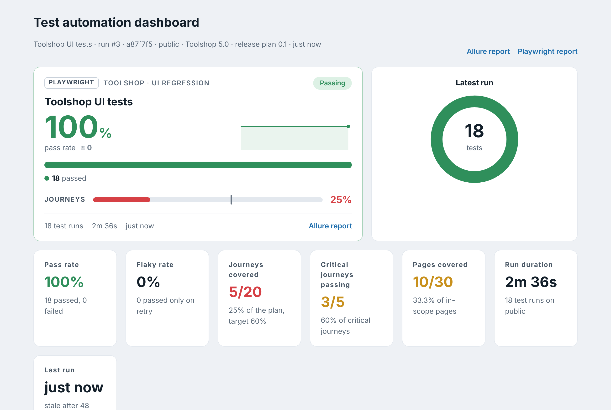
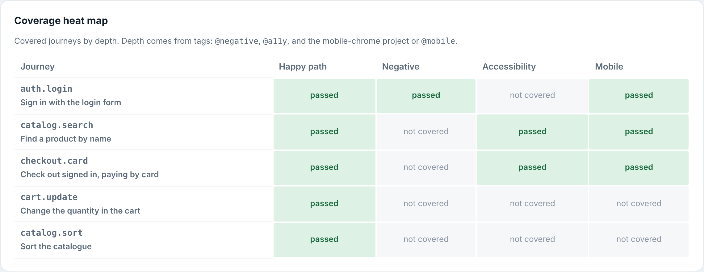
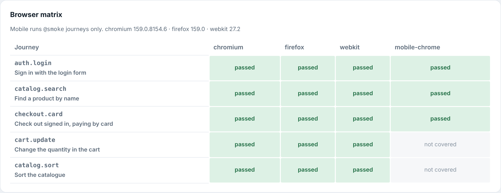
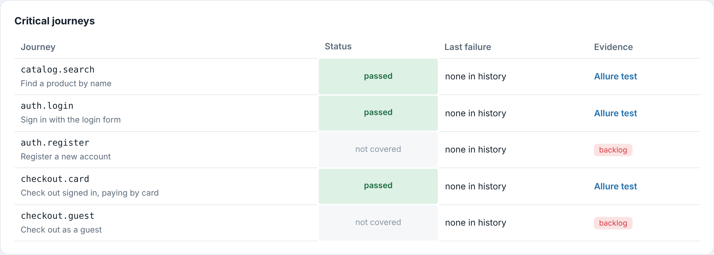
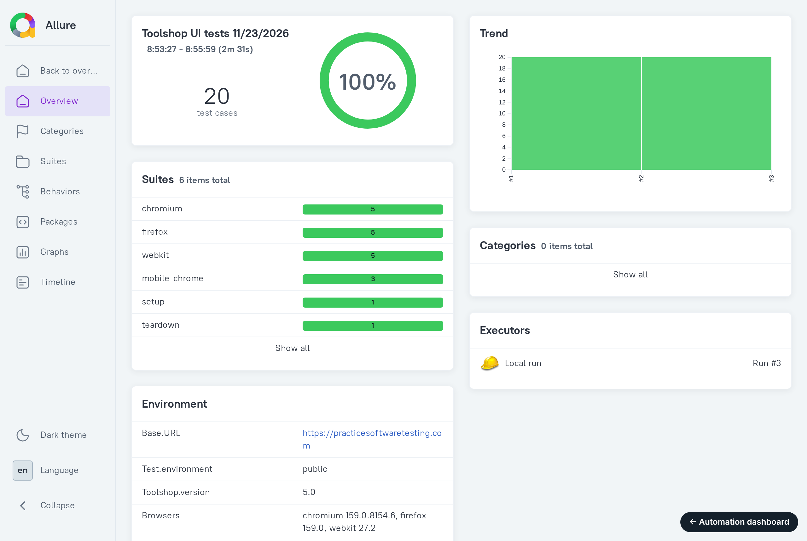
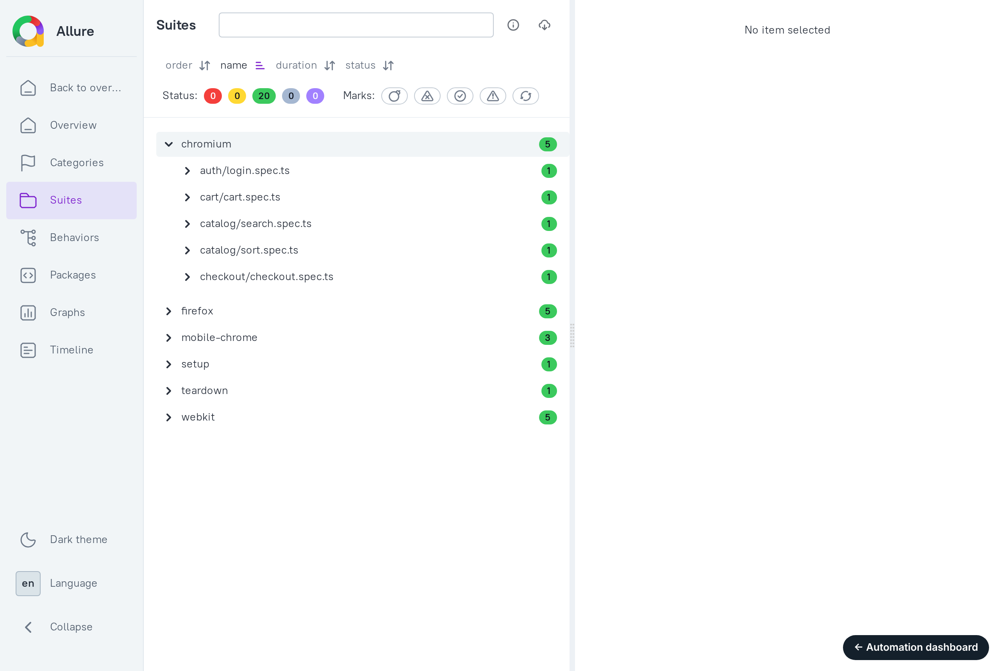
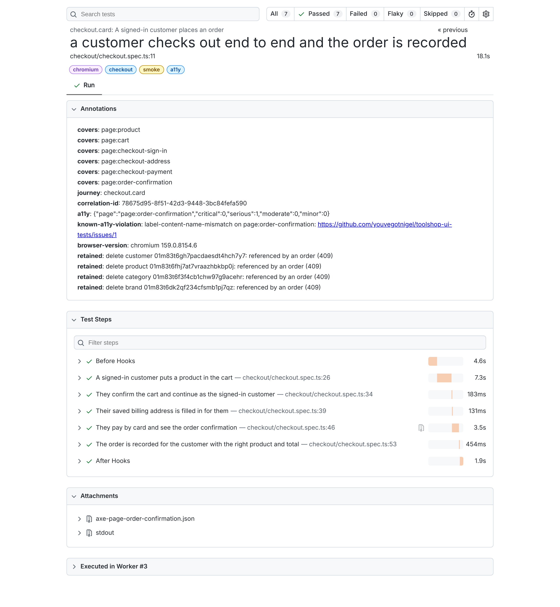
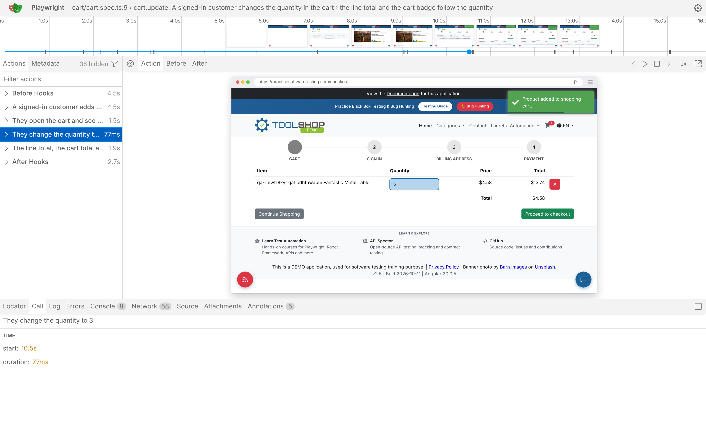

# Toolshop UI tests

[](https://github.com/youvegotnigel/toolshop-ui-tests/actions/workflows/ci.yml)

Agentic **Playwright + TypeScript** UI test framework for the
[Practice Software Testing Toolshop](https://practicesoftwaretesting.com) (Angular front end, API at
`api.practicesoftwaretesting.com`). It starts with five UI tests that exercise every framework feature and is
built to grow page by page, by people and by AI agents (Claude Code and GitHub Copilot share the same rules,
skills, agents and commands).

Sister project: [toolshop-api-tests](https://github.com/youvegotnigel/toolshop-api-tests) (same conventions).

**Live reports:** https://youvegotnigel.github.io/toolshop-ui-tests/ (automation dashboard), with the
[Allure report](https://youvegotnigel.github.io/toolshop-ui-tests/allure/), the
[Playwright report](https://youvegotnigel.github.io/toolshop-ui-tests/playwright/) and the
[smart report](https://youvegotnigel.github.io/toolshop-ui-tests/smart/), updated by every full CI run on `main`.

## What it covers

| Journey                 | Spec                                  | What it proves                                                                                        | Tags                     |
| ----------------------- | ------------------------------------- | ----------------------------------------------------------------------------------------------------- | ------------------------ |
| `catalog.search`        | `tests/catalog/search.spec.ts`        | A shopper finds a product by name; the detail page shows name, price and brand; WCAG 2.2 AA           | `@catalog @smoke @a11y`  |
| `catalog.sort`          | `tests/catalog/sort.spec.ts`          | Price sorting, low to high and high to low (data-driven over the sort options)                        | `@catalog`               |
| `auth.login`            | `tests/auth/login.spec.ts`            | A wrong password is refused without a session; the right one opens the account                        | `@auth @smoke @negative` |
| `auth.login-validation` | `tests/auth/login-validation.spec.ts` | Data-driven: the sign-in form flags each invalid field before sending it (4 rows, one test each)      | `@auth @negative`        |
| `cart.update`           | `tests/cart/cart.spec.ts`             | Changing the quantity updates the line total, cart total and badge                                    | `@cart`                  |
| `checkout.card`         | `tests/checkout/checkout.spec.ts`     | End-to-end checkout paid by card, order confirmed in the UI and verified through the API; WCAG 2.2 AA | `@checkout @smoke @a11y` |

Every spec creates its own data through the API and removes it afterwards; all five run on Chromium, Firefox and
WebKit, and the `@smoke` ones on a Pixel 7 too.

## Features

- **Page Object Model with fluent navigation**: locators as readonly properties, user intentions as methods,
  `await cartPage.proceed()` returns a ready `SignInStep`. Shared parts (`Header`, `CartBadge`, `ProductCard`) are
  components. No assertions in page objects except `waitForReady()`.
- **Fixtures are the framework**: `auth -> api -> data -> pages`. Specs import `test`/`expect` from `src/fixtures`
  and never call `page.goto`, the API or `new` a page object (ESLint enforces it).
- **Sign-in through the API**: Toolshop JWTs live 5 minutes, so a fresh token per test is injected with
  `addInitScript`; only the login test types a password. Each worker registers its own customer (shared demo
  accounts lock on failed logins).
- **Own, run-tagged data**: brands, categories, products (with stock) and customers carry `qa-<RUN_ID>`; cleanup
  runs newest first even on failure, and a teardown sweep catches leftovers. Orders are permanent in the Toolshop,
  so the records an order references are kept (HTTP 409) and reported, not failed.
- **Accessibility**: `@axe-core/playwright` audits WCAG 2.2 AA; serious and critical violations fail the test,
  with a readable list and the full axe JSON attached. Known site defects are a baseline matched by rule, page and
  element, each with an issue ([#1](https://github.com/youvegotnigel/toolshop-ui-tests/issues/1)).
- **Two sites, one suite**: `TEST_ENV=with-bugs` runs the same specs against the deliberately buggy build.
- **Evidence for every failure**: trace, screenshot and video (failures only), the API call log of the test data
  setup, the axe report, a correlation id and the failed business step in `failure-summary.json` and the job summary.
- **Secrets stay secret**: the logger and the API recorder mask passwords and JWTs; `scripts/ci/redact-traces.mts`
  rewrites every trace, blob and HTML report so the `Authorization: Bearer` headers the browser sends are masked
  before anything is uploaded or published.
- **One link for managers**: a GitHub Pages site with the automation dashboard, Allure 3 (with history and
  categories) and the merged Playwright HTML report.
- **Agent-ready**: `AGENTS.md` as the single source of truth, nine skills, four agents and four commands for both
  Claude Code and GitHub Copilot, a parity check and a constitution scan.

## Screenshots

| Automation dashboard                                                | Coverage heat map                                                 |
| ------------------------------------------------------------------- | ----------------------------------------------------------------- |
|          |            |
| **Browser matrix**                                                  | **Critical journeys**                                             |
|          |  |
| **Allure overview**                                                 | **Allure suites**                                                 |
|                  |                    |
| **Playwright report: business steps**                               | **Trace viewer**                                                  |
|  |                             |

## Requirements

- Node.js 24 (`.nvmrc`), npm
- Network access to `practicesoftwaretesting.com` and `api.practicesoftwaretesting.com`
  (and the `with-bugs` hosts for that environment)
- The Toolshop admin password (public demo value, published in the
  [Toolshop repository](https://github.com/testsmith-io/practice-software-testing))

## Setup

```bash
npm ci
npx playwright install --with-deps chromium firefox webkit
cp .env.example .env.local   # then set ADMIN_PASSWORD (git-ignored, never committed)
```

`.env.public` and `.env.with-bugs` hold the non-secret settings per environment (base URLs, API dialect,
routing, token storage). Real values in the environment (CI secrets) win over the files.

## Running the tests

| What                                 | Command                                                                 |
| ------------------------------------ | ----------------------------------------------------------------------- |
| Everything (all browsers + mobile)   | `npm test`                                                              |
| One browser                          | `npm run test:chromium` (`test:firefox`, `test:webkit`, `test:mobile`)  |
| Smoke                                | `npm run test:smoke`                                                    |
| Headed / UI mode                     | `npm run test:headed` / `npm run test:ui`                               |
| Shuffled and repeated (independence) | `npm run test:shuffle`                                                  |
| Against the buggy Toolshop           | `npm run test:with-bugs`                                                |
| One test                             | `npx playwright test tests/cart/cart.spec.ts --project=webkit`          |
| Everything a PR needs                | `npm run verify` (typecheck, lint, format, agent parity, tests)         |
| Reports locally                      | `ALLURE=1 npm test && npm run report:site`, then open `site/index.html` |

Behind a TLS-inspecting proxy whose CA Firefox does not trust, set `TRUST_INTERCEPTING_PROXY=1` (local only,
ignored in CI). `HTTPS_PROXY` is honoured by browsers and API contexts.

### Against `with-bugs` (proof that the suite catches defects)

The [with-bugs](https://with-bugs.practicesoftwaretesting.com) build is an older Toolshop with seeded defects.
The framework absorbs its technical differences (numeric ids, flat addresses, hash routes, the JWT in
`sessionStorage`; see `src/api/dialect.ts` and `.env.with-bugs`), so every failure there is a business
assertion. Latest run (Chromium, Firefox, WebKit):

| Test             | Fails on with-bugs because                                                                                                                                  |
| ---------------- | ----------------------------------------------------------------------------------------------------------------------------------------------------------- |
| `catalog.search` | The product page has 4 serious/critical WCAG violations: unnamed quantity buttons, a `broken.png` image without alt text, an unlabelled input, low contrast |
| `catalog.sort`   | Price sorting returns the wrong order (which direction fails varies by run: an unstable sort)                                                               |
| `auth.login`     | After a successful sign-in the header shows "User Data not found" instead of the customer's name                                                            |
| `cart.update`    | The cart shows a line total of `$00.00` instead of the price                                                                                                |
| `checkout.card`  | The saved postcode is not pre-filled on the address step (possibly an old-build difference: its API calls it `postcode`)                                    |

## CI/CD

**GitHub Actions** (`.github/workflows/ci.yml`) on pull requests, pushes to `main`, nightly and on demand
(`workflow_dispatch` with `test_env` and `grep`):

1. `quality`: typecheck, lint (0 warnings), format, agent parity.
2. `test`: one job per browser project (`npx playwright install --with-deps <browser>`), blob and Allure results
   uploaded, traces redacted first; failures upload `test-results/` and write a failures table to the job summary.
3. `report`: merges the blobs into one HTML report, restores history from `gh-pages`, builds the dashboard and
   Allure, writes the dashboard numbers to the job summary, uploads the site as an artifact, and **publishes to
   GitHub Pages only from full runs on `main` against `public`** (never PRs, `--grep` subsets or `with-bugs`).

Required: the repository secret `TOOLSHOP_ADMIN_PASSWORD` (add it under **Actions** and under **Dependabot**
secrets, because Dependabot runs cannot read Actions secrets).

**Cloudflare-guarded tests.** From GitHub-hosted runners, Cloudflare answers the post-login `/account` page with a
"Verify you are human" challenge. `auth.login` is therefore tagged `@cloudflare-guarded` and skipped on GitHub-hosted
runners only (`RUNNER_ENVIRONMENT=github-hosted`), with the reason shown in the HTML report, Allure and the
dashboard. It always runs locally (`npm test`, UI mode, headed), on Jenkins and on self-hosted runners. To force it
on GitHub-hosted runners (e.g. to check whether Cloudflare still challenges them), set the repository variable
`RUN_CLOUDFLARE_GUARDED_TESTS` to `1` (Settings > Secrets and variables > Actions > Variables). To publish, enable Pages once:
**Settings > Pages > Build and deployment > Deploy from a branch > `gh-pages` / (root)**. The `gh-pages` branch
always holds one commit; trend history lives in `history/` on it and survives every publish (last 30 runs).

**Jenkins** (`Jenkinsfile`) runs the same stages in `mcr.microsoft.com/playwright:v1.65.1-noble` (keep the tag equal
to `@playwright/test`) and publishes "Automation Dashboard", "Allure", "Playwright" and "Smart Report" with the HTML Publisher
plugin. Credential: `toolshop-admin-password` (Secret text). Allure, Playwright and smart reports need JavaScript, so relax
Jenkins' Content Security Policy for HTML Publisher (`hudson.model.DirectoryBrowserSupport.CSP`).

Also included: Dependabot (npm and actions), CODEOWNERS, a PR template, a "UI test request" issue template and an
importable ruleset for `main` (`.github/rulesets/protect-main.json`: Settings > Rules > Rulesets > Import).

## Reports and the coverage plan

- **Playwright HTML report**: one report across browsers and shards; filter by browser, tag (`@smoke`) or text.
  The `test.step` titles tell the story, so a failure is readable without code.
- **Allure 3** (`allurerc.yml`, awesome and classic layouts): trends, categories (product defect, accessibility,
  test defect, test data, environment, flaky), environment (base URL, Toolshop version, browser versions,
  commit, run) and executor. Labels come from the tests: area tag -> feature, journey -> story,
  `@smoke` -> critical, browser -> parent suite.
- **Smart report** ([playwright-smart-reporter](https://github.com/qa-gary-parker/playwright-smart-reporter),
  `src/reporting/smart-report.ts`): failure clusters, stability grades (A to F), flakiness, retry analysis,
  trends over the last 30 runs, a built-in trace viewer, network logs and the accessibility summary. GitHub Actions
  builds it once over every browser shard (`merge.config.ts`); Jenkins and local runs build it during the run
  (`smart-report/index.html`). History lives in `smart-history/` and on `gh-pages` like Allure's. Report text is
  redacted for JWTs and AI analysis is off. Open traces with one click: `npx playwright-smart-reporter-serve smart-report/index.html`.
- **Automation dashboard** (`scripts/coverage/`): pass and flaky rate, journeys covered against the plan,
  critical journeys passing, pages covered, duration, last run (stale after 48 hours), trends, the coverage heat
  map (journey x depth), the browser matrix, critical journeys with links to Allure, the accessibility summary and
  the "not yet covered" backlog.

UI has no OpenAPI to measure against, so **`coverage-plan.json` is the plan**: the site's pages (from the Angular
routes) and the user journeys, each with an area, a priority and a target release. It is the only file people
maintain by hand, together with two conventions in the specs:

1. The describe title starts with the journey id: `test.describe('checkout.card: A signed-in customer places an order', ...)`.
2. Every page a test visits is declared: `{ annotation: { type: 'covers', description: 'page:cart' } }`.
   Depth comes from tags: `@negative`, `@a11y`, and `@smoke` (which also runs on mobile).

## Project structure

```
playwright.config.ts      env loading, RUN_ID, testIdAttribute 'data-test', reporters, projects
merge.config.ts           reporters for merging CI shards
coverage-plan.json        pages and journeys the dashboard measures against
src/config/env.ts         .env.local + .env.<TEST_ENV>, env(), runId(), proxy, routing, token storage
src/api/                  minimal clients + zod schemas (test data, auth, verification), API dialects
src/auth/auth-session.ts  worker-scoped API login, renews the 5 minute JWT
src/pages/                page objects (checkout/ holds the wizard steps)
src/components/           Header, CartBadge, ProductCard
src/fixtures/             auth -> api -> data -> pages, exported by src/fixtures/index.ts
src/data/                 faker builders, checkout data, sort options
src/utils/                logger, api-recorder, a11y audit and known violations, report labels
src/reporting/            failure tracker (failure-summary.json, job summary), smart report options
scripts/coverage/         automation dashboard
scripts/ci/               redact-traces, allure-environment, build-site, restore-history, publish-pages
scripts/                  agent-parity, scan-constitution, hooks/
tests/<area>/             specs; tests/setup/ holds the environment check and the teardown sweep
.claude/                  skills (shared), agents, commands, settings and hook (Claude Code)
.github/                  workflows, Copilot instructions, agents and prompts, templates, ruleset
AGENTS.md                 the single source of truth for humans and agents
```

## Working with AI agents (Claude Code and GitHub Copilot)

The framework is built to be extended by agents, with the same guard rails for both tools. The workflow is
adapted from [idavidov13/agentic-playwright](https://github.com/idavidov13/agentic-playwright):
**explore the live site, propose with a confidence score, wait for your approval, apply, verify, report.**

### Where things live

| What        | Claude Code                                 | GitHub Copilot                                                             |
| ----------- | ------------------------------------------- | -------------------------------------------------------------------------- |
| Rules       | `CLAUDE.md` -> `AGENTS.md`                  | `.github/copilot-instructions.md` -> `AGENTS.md`, `.github/instructions/*` |
| Skills      | `.claude/skills/*` (also `/skill-name`)     | `.claude/skills/*` (read as agent skills)                                  |
| Agents      | `.claude/agents/*.md` (subagents)           | `.github/agents/*.agent.md` (custom agents)                                |
| Commands    | `.claude/commands/*.md` (`/verify` ...)     | `.github/prompts/*.prompt.md` (`/verify` ...)                              |
| Exploration | `npx playwright-cli` (`explore-site` skill) | `npx playwright-cli` (`explore-site` skill)                                |
| Guard rails | lint-on-edit hook, `scan-constitution`      | `copilot-setup-steps.yml`, `scan-constitution`                             |

`npm run agent:parity` (in CI) fails when a Claude file and its Copilot mirror drift, or when an agent names a
skill that does not exist.

### Skills

| Skill                | Use it when you want to...                                                  |
| -------------------- | --------------------------------------------------------------------------- |
| `ai-native-workflow` | start any non-trivial task: it routes to the right skill and gates the plan |
| `explore-site`       | look at a page with `playwright-cli` before writing UI code                 |
| `data-driven-tests`  | one test per row of a typed cases table; guide in `docs/testing-patterns/`  |
| `selectors`          | pick or fix a locator                                                       |
| `test-data`          | give a test its own data, or understand a 409 in cleanup                    |
| `add-ui-test`        | automate a journey end to end                                               |
| `add-page-object`    | add a page, a checkout step or a component                                  |
| `review-ui-tests`    | review a branch or PR                                                       |
| `triage-ui-failures` | understand a red run                                                        |
| `fix-flaky-test`     | root-cause a flake (never with sleeps or retries)                           |

### Example prompts

Claude Code (terminal or IDE) and Copilot Chat in agent mode accept the same prompts; in Copilot pick the custom
agent from the agent picker, or type the prompt file name (`/new-ui-test`).

**Automate a new journey** (backlog item from the dashboard):

```text
/new-ui-test checkout.guest
```

```text
Use the ai-native-workflow skill. Add a test for the journey cart.remove from coverage-plan.json:
a signed-in customer removes the only item from the cart and the cart becomes empty.
Explore /checkout with playwright-cli first and show me the proposal before writing code.
```

**Add a page object**:

```text
Use the add-page-object skill to create InvoicesPage for /account/invoices (signed-in customer).
Explore it with playwright-cli on desktop and on a phone, and list the data-test attributes you will use.
```

**Explore only** (Copilot: choose the `journey-analyst` agent):

```text
@journey-analyst Explore the guest checkout on https://practicesoftwaretesting.com and write the brief:
steps, pages, data, locators, and anything that loads late or collapses on phones. Do not edit files.
```

**Fix a locator**:

```text
Use the selectors skill: the cart badge locator in src/components/cart-badge.component.ts fails in strict
mode on mobile-chrome. Find out why with playwright-cli and fix it without CSS or force.
```

**Triage a red run**:

```text
/triage 12345678901
```

```text
Use the triage-ui-failures skill on test-results/failure-summary.json. Classify every failure
(product bug, test bug, test data, flaky, environment) with the evidence, and propose fixes. Do not change
expected values.
```

**Fix a flaky test**:

```text
Use the fix-flaky-test skill: tests/cart/cart.spec.ts fails about 1 in 10 runs on webkit.
Reproduce it with --repeat-each=10, find the race in the trace and fix it without sleeps or retries.
```

**Review before a PR** (Copilot: choose the `ui-test-reviewer` agent):

```text
/review
```

**Run the quality gate**:

```text
/verify
```

**Ask the workflow which skill fits**:

```text
Use the ai-native-workflow skill: I want the dashboard to show a new journey for favourites. What do I change,
and in which order?
```

What to expect: for anything non-trivial the agent first explores and answers with a **Proposal** block (scope,
steps, data, confidence 1 to 10, unknowns) and waits. Reply "approve", "change X" or "no, because Y". It then
implements, runs `npm run verify` and the new specs repeated and shuffled, and reports the files, steps, pages
covered and the teardown sweep line. It asks before committing.

### Copilot cloud agent

`.github/workflows/copilot-setup-steps.yml` installs Node, dependencies and browsers. Allow
`practicesoftwaretesting.com` and `api.practicesoftwaretesting.com` in the repository's Copilot firewall settings and
provide `ADMIN_PASSWORD` to the Copilot environment. Assign an issue created from the **UI test request**
template; the agent follows the same skills and opens a PR for review.

## Contributing

1. Pick a journey from the dashboard's "Not yet covered" list (or add it to `coverage-plan.json`).
2. Branch, then follow `AGENTS.md` (or ask an agent with the prompts above).
3. `npm run verify` and `node scripts/scan-constitution.mts` must be green; fill in the PR template.
4. Husky runs ESLint and Prettier on staged files; CI runs everything on every browser.

## Licence

[MIT](LICENSE)
